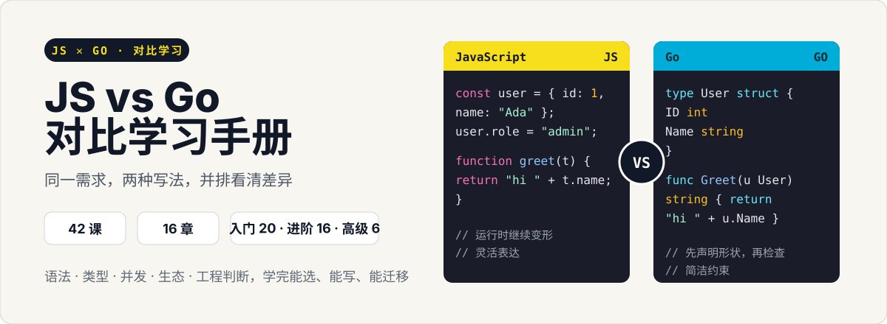
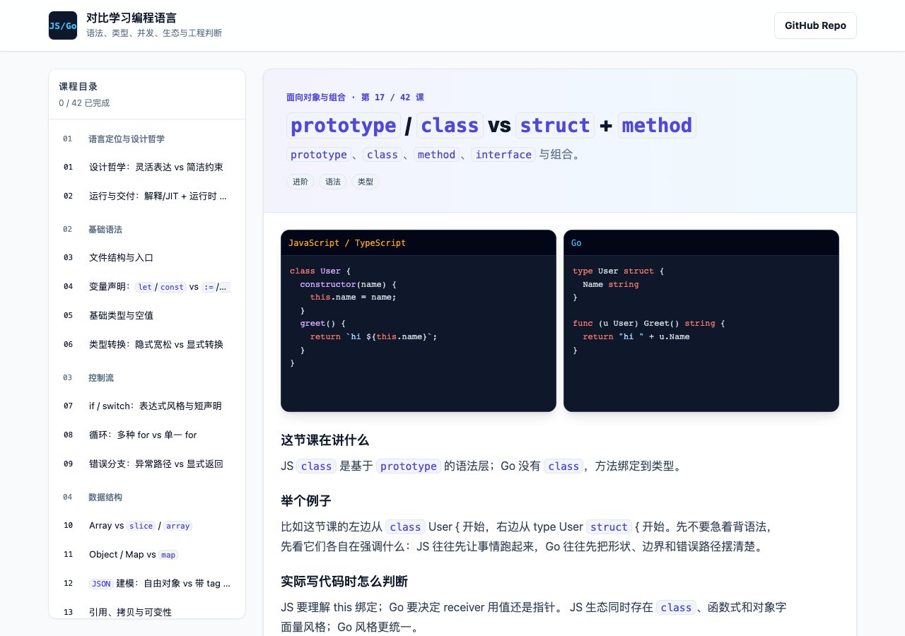

<p align="right"><a href="README.md">中文</a></p>

<p align="center">
  
</p>

<p align="center">
  <a href="https://holynova.github.io/js-go-compare/">▶ Start Learning</a>
  ·
  <a href="https://github.com/holynova/js-go-compare">GitHub Repository</a>
</p>

JS vs Go is a single-page course site: 42 lessons in 16 chapters comparing JavaScript and Go side by side — syntax, types, concurrency, ecosystem. Each lesson shows the same task in both languages (JS on the left, Go on the right), then explains the difference, how to judge in real code, and what trips you up when learning the other language. Includes a course outline and progress tracking; mobile-friendly.

## Screenshot

<p align="center">
  
</p>

## Curriculum

42 lessons, 16 chapters, three difficulty levels （入门 Beginner 20 / 进阶 Intermediate 16 / 高级 Advanced 6):

| Chapter | Lessons | Content |
| :--- | :---: | :--- |
| 语言定位与设计哲学 (Positioning & Design Philosophy) | 2 | Expressive flexibility vs simple constraints; interpreted/JIT vs compiled binaries |
| 基础语法 (Basics) | 4 | Entry point, variable declarations, basic types and null values, type conversion |
| 控制流 (Control Flow) | 3 | if / switch, loops, error branches |
| 数据结构 (Data Structures) | 4 | Array vs slice, Object/Map vs map, JSON modeling, references and copying |
| 函数与作用域 (Functions & Scope) | 3 | Declarations and multiple return values, closures, default and rest parameters |
| 面向对象与组合 (OOP & Composition) | 3 | prototype / class vs struct + method, interface, composition over inheritance |
| 错误处理 (Error Handling) | 2 | try/catch vs error return values, panic / recover |
| 异步与并发 (Async & Concurrency) | 2 | Event loop and async-await, channel / select vs Promise |
| 模块与包管理 (Modules & Packages) | 2 | ES Modules vs Go import, npm vs Go module |
| 类型系统 (Type System) | 2 | Dynamic typing and TypeScript, generics |
| 标准库与常用库 (Stdlib & Libraries) | 2 | HTTP, where each ecosystem is deep |
| Web 开发生态 (Web Ecosystems) | 2 | Frontend / BFF / API, framework landscape |
| 工具链与工程体验 (Tooling & DX) | 3 | Formatting and lint, testing, builds and CI |
| 性能与内存模型 (Performance & Memory) | 2 | JIT vs compilation, GC and cold starts |
| 典型应用场景 (Typical Use Cases) | 3 | When to pick JS, when to pick Go, when to combine |
| 迁移与互学指南 (Migration & Cross-Learning) | 3 | JS devs learning Go, Go devs learning JS, one task in two idioms |

Every lesson has the same shape: JS code, Go code, an explanation of the difference (what this lesson is about), a worked example, practical judgment (how to choose when writing code), and an ecosystem note.

## Learning Features

- **Course outline**: the left sidebar groups lessons by chapter — jump to any lesson, or move through them in order with prev/next.
- **Progress tracking**: mark each lesson done; progress is saved in the browser's localStorage, and the outline header shows 「x / 42 已完成」 ("x / 42 done").
- **Code highlighting**: JS and Go code shown side by side with syntax highlighting; on mobile they stack vertically.
- **Difficulty labels**: every lesson is tagged 入门 (Beginner) / 进阶 (Intermediate) / 高级 (Advanced), so you can pick by level.

## Run Locally

Pure static single page, zero build, zero dependencies:

```bash
npm start
# Serves via python3 -m http.server 5173; open http://localhost:5173
```

Self-check script (validates the embedded JS syntax): `npm run check`.

## Tech

- A single `index.html` (~69KB): styles, the 42-lesson dataset, and all rendering logic in one file, zero dependencies.
- Course data is a JS array (`topics`); each lesson has `jsCode` / `goCode` / `difference` / `advice` / `ecosystemNote`.
- Progress is saved in `localStorage` (key `js-go-progress`) as a set of completed lesson ids.

```
index.html                  The whole single page: styles + course data + rendering
package.json                start (static server) / check (syntax self-check)
screenshot.png              Old screenshot (kept)
assets/demo-share-card.png  Demo share card (kept)
```
