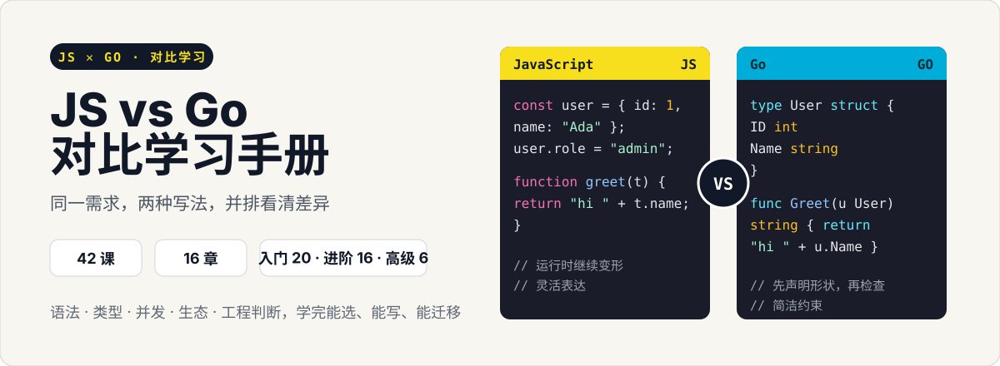
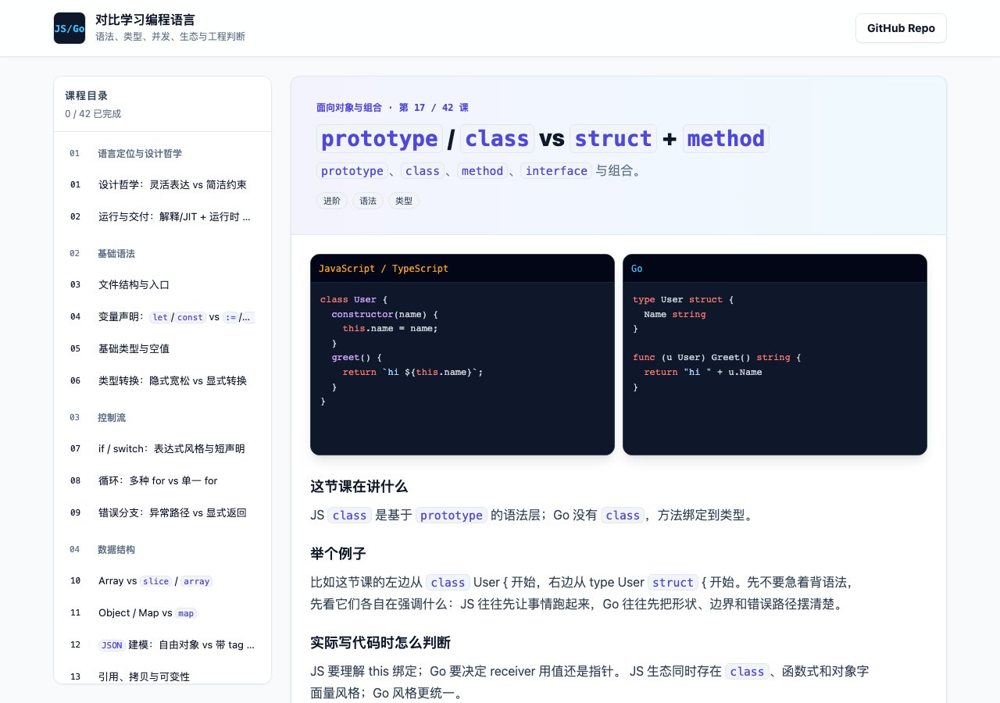

<p align="center">
  
</p>

<p align="center">
  <a href="https://holynova.github.io/js-go-compare/">▶ 在线学习 Start Learning</a>
  ·
  <a href="https://github.com/holynova/js-go-compare">GitHub 仓库</a>
</p>

JS vs Go 对比学习手册是一个单页课程网站：42 课、16 章，把 JavaScript 与 Go 的语法、类型、并发、生态放在一起并排对比。每一课都是同一需求的两种写法——左边 JS、右边 Go——再讲清差异在哪、实际写代码时怎么判断、学另一门语言时最容易误判什么。带课程目录与学习进度，手机上也能学。

JS vs Go is a single-page course site: 42 lessons in 16 chapters comparing JavaScript and Go side by side — syntax, types, concurrency, ecosystem. Each lesson shows the same task in both languages (JS on the left, Go on the right), then explains the difference, how to judge in real code, and what trips you up when learning the other language. Includes a course outline and progress tracking; mobile-friendly.

## 截图 / Screenshots

<p align="center">
  
</p>

## 课程内容 / Curriculum

42 课，16 章，三档难度（入门 20 / 进阶 16 / 高级 6）：

| 章 | 课数 | 内容 |
| :--- | :---: | :--- |
| 语言定位与设计哲学 | 2 | 灵活表达 vs 简洁约束；解释/JIT vs 编译后二进制 |
| 基础语法 | 4 | 入口、变量声明、基础类型与空值、类型转换 |
| 控制流 | 3 | if / switch、循环、错误分支 |
| 数据结构 | 4 | Array vs slice、Object/Map vs map、JSON 建模、引用与拷贝 |
| 函数与作用域 | 3 | 声明与多返回值、闭包、默认参数与剩余参数 |
| 面向对象与组合 | 3 | prototype / class vs struct + method、interface、组合优先 |
| 错误处理 | 2 | try/catch vs error 返回值、panic / recover |
| 异步与并发 | 2 | event loop 与 async-await、channel / select vs Promise |
| 模块与包管理 | 2 | ES Modules vs Go import、npm vs Go module |
| 类型系统 | 2 | 动态类型与 TypeScript、泛型 |
| 标准库与常用库 | 2 | HTTP、生态厚度的方向 |
| Web 开发生态 | 2 | 前端/BFF/API、框架版图 |
| 工具链与工程体验 | 3 | 格式化与 lint、测试、构建与 CI |
| 性能与内存模型 | 2 | JIT vs 编译、GC 与冷启动 |
| 典型应用场景 | 3 | 何时选 JS、何时选 Go、何时组合 |
| 迁移与互学指南 | 3 | JS 学 Go、Go 学 JS、同一需求练两种表达 |

每一课固定包含：JS 代码、Go 代码、差异讲解（这节课在讲什么）、举例、实际判断（写代码时怎么选）、生态备注。

## 学习功能 / Features

- **课程目录**：左侧目录按章分组，点击直达任意一课；支持上一课 / 下一课顺序学习。
- **学习进度**：每课可标记完成，进度保存在浏览器本地（localStorage），目录顶部显示「x / 42 已完成」。
- **代码高亮**：JS 与 Go 代码并排展示，语法高亮，移动端自动上下排列。
- **难度标识**：每课标注入门 / 进阶 / 高级，可按自己的水平挑着学。

## 本地运行 / Run Locally

纯静态单页，零构建、零依赖：

```bash
npm start
# 即 python3 -m http.server 5173，打开 http://localhost:5173
```

自检脚本（校验内嵌 JS 语法）：`npm run check`。

## 技术 / Tech

- 单个 `index.html`（约 69KB）：样式 + 42 课数据 + 渲染逻辑全在一个文件里，零依赖。
- 课程数据是 JS 数组（`topics`），每课含 `jsCode` / `goCode` / `difference` / `advice` / `ecosystemNote`。
- 进度用 `localStorage`（键 `js-go-progress`）保存已完成课程 id 集合。

```
index.html                  单页全部内容：样式 + 课程数据 + 渲染
package.json                start（静态服务器）/ check（语法自检）
screenshot.png              旧截图（保留）
assets/demo-share-card.png  Demo 分享卡片（保留）
```

## English

**JS vs Go** is a single-page course site comparing JavaScript and Go: 42 lessons in 16 chapters, each showing the same task in both languages side by side.

- **Curriculum**: positioning & philosophy, basics, control flow, data structures, functions, composition (prototype/class vs struct/method), errors, async & concurrency (event loop vs goroutines/channels), modules, types (incl. generics), stdlib, web ecosystems, tooling, performance, use cases, and migration guides. Difficulty: 20 beginner / 16 intermediate / 6 advanced.
- **Every lesson has the same shape**: JS code, Go code, what the difference is, a worked example, how to judge in real code, and an ecosystem note.
- **Features**: chapter-grouped outline with jump-to-lesson, prev/next navigation, per-lesson completion tracking saved in `localStorage` ("x / 42 done"), side-by-side syntax-highlighted code, mobile-friendly layout.
- **Run it**: `npm start` (serves on port 5173) — no build step, no dependencies. `npm run check` validates the embedded JS.
- **Tech**: a single `index.html` (~69KB) holding styles, the 42-lesson `topics` data array, and all rendering logic.

## 许可 / License

MIT 协议（`package.json` 声明；仓库内暂无 LICENSE 文件）。
